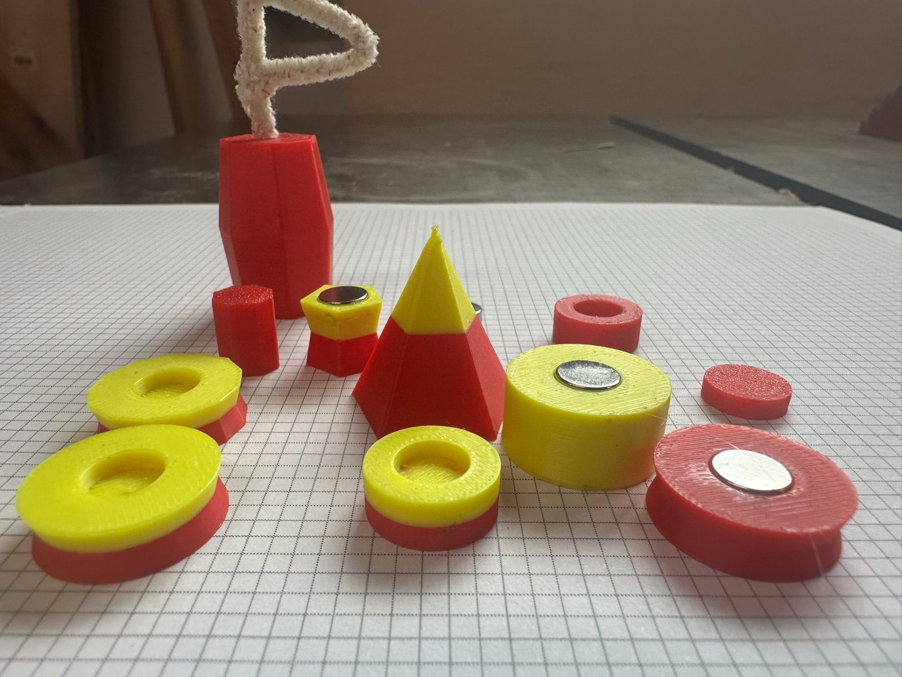
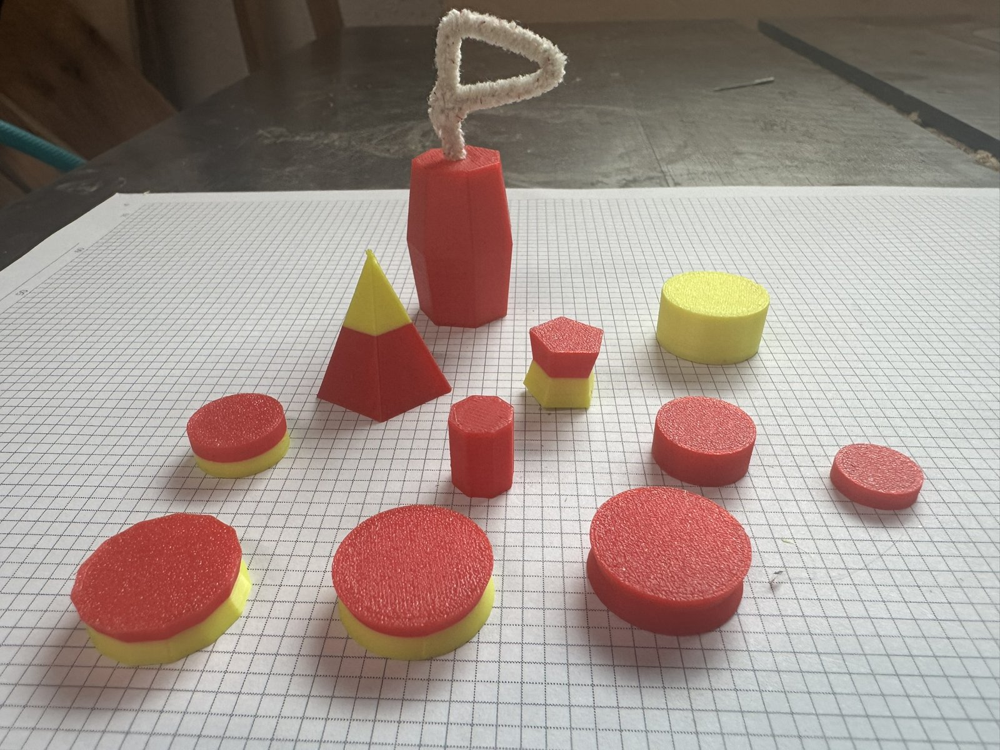
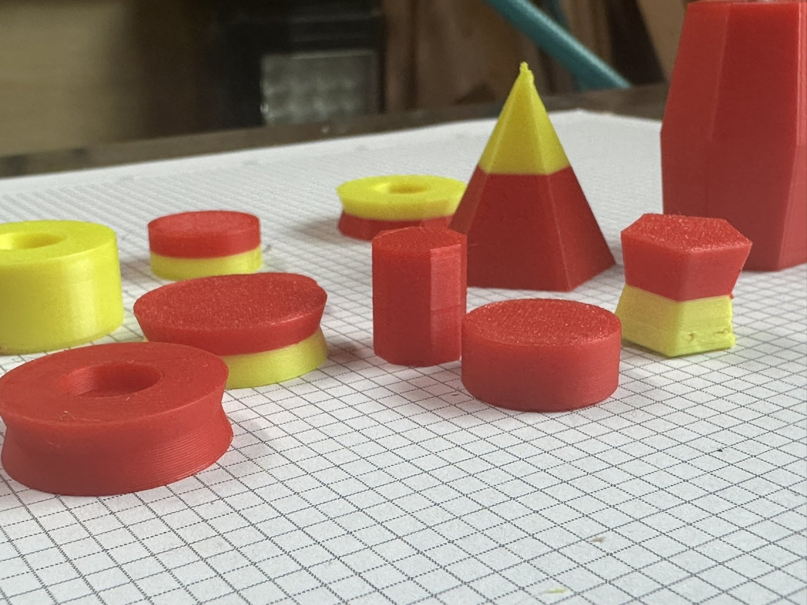
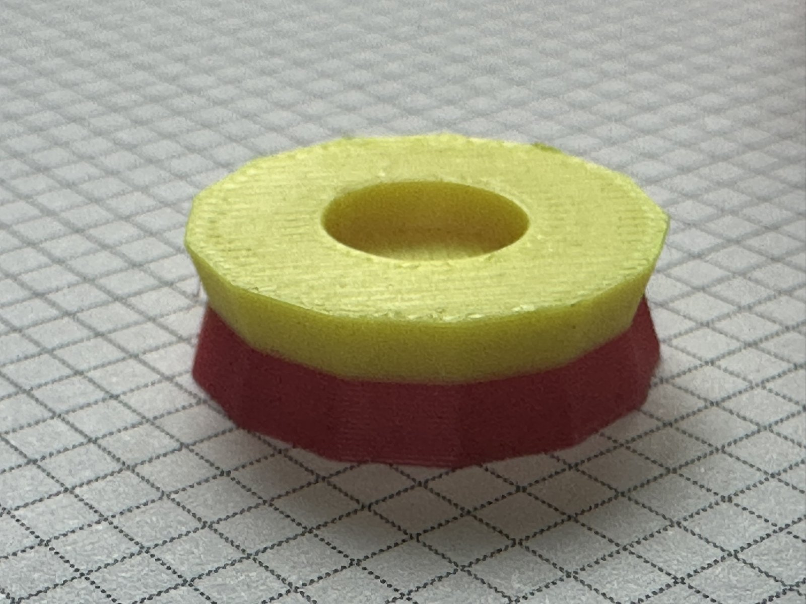
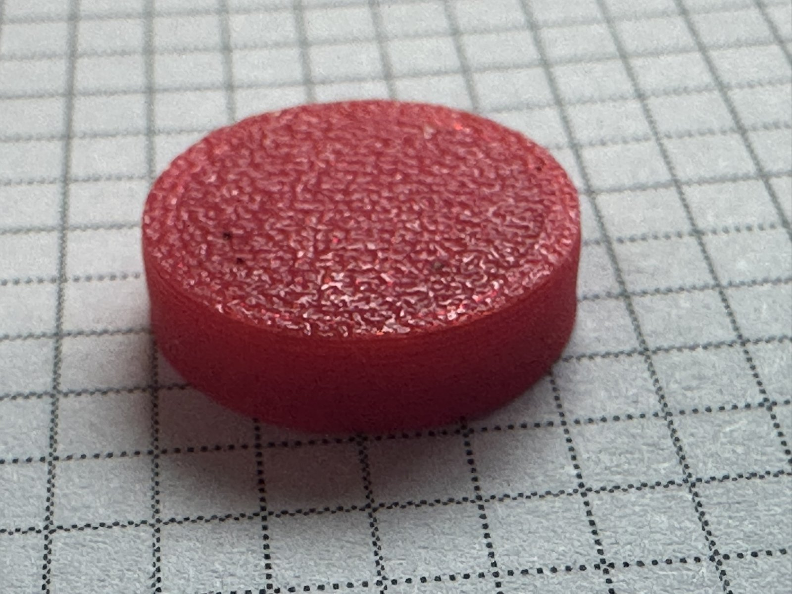
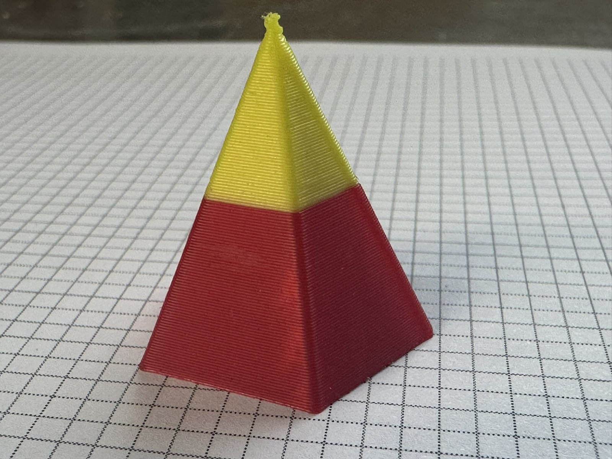
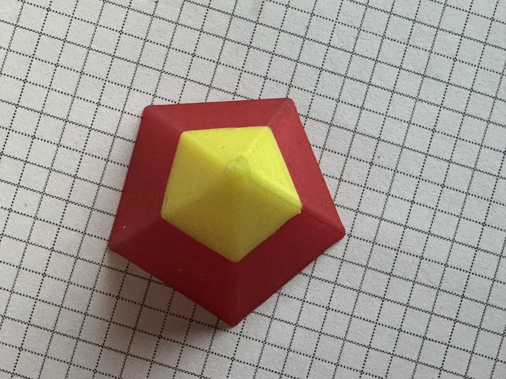
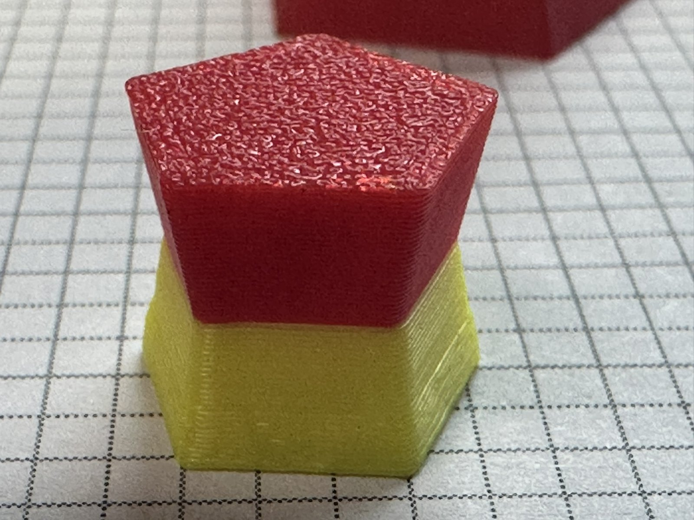
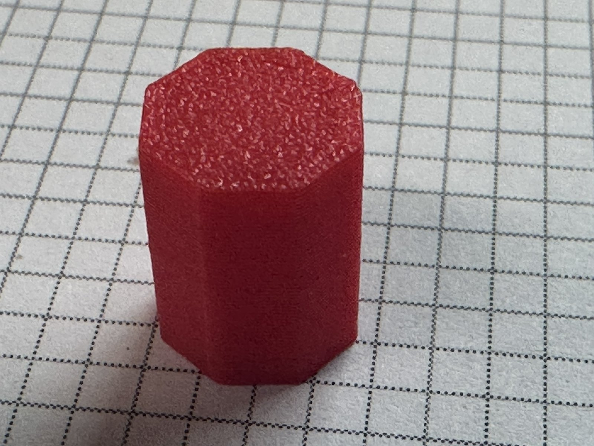
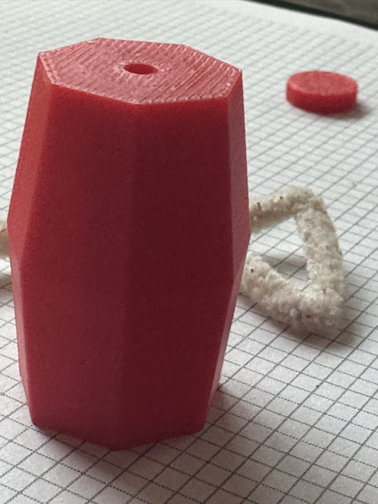

# Game Token Generator

A parameterized OpenSCAD model for 3D-printing board-game tokens and game pieces.
It started as a piece for a travel backgammon set and grew from there.

A token can:

- be one color or two, split into horizontal layers. A two-color token needs only
  one filament change, so you can print it without an AMS.
- be any height, with separate diameters at the bottom, the neck (where the color
  changes) and the top, so it can be a cylinder, a cone, a pyramid, a waisted
  spool or a barrel.
- be any regular polygon in cross-section: 3 sides for a triangle, 4 for a square,
  200 or more for a token that looks round.
- have an optional round recess in one face for a magnet, or for a flag or other
  marker.

The model is also published on MakerWorld as
[Game Token Generator](https://makerworld.com/en/models/3348797-game-token-generator),
along with sample plates.

## Files

| File | What it is |
| --- | --- |
| `token.scad` | The OpenSCAD model. All settings are at the top of the file. |
| `images/` | Photos of printed tokens. |

## Quick start

1. Open `token.scad` in [OpenSCAD](https://openscad.org/).
2. Open the Customizer (Window → Customizer) and set the parameters below.
3. Render (F6) and export:
   - **STL** for a single-color token.
   - **3MF** for a two-color token (see [Two-color tokens](#two-color-tokens)).
4. Slice and print. No supports are needed for straight or inward-sloping sides.

## Which way is up

The token prints **upside down**: its top face goes on the build plate, so the
magnet recess in the bottom face is open to the air and prints without supports.
OpenSCAD's preview shows it the same way, upside down, so in the preview the
"bottom" (with the recess) is at the top.

On a textured plate, the top face picks up the plate's texture, as you can see in
several of the photos.

If you use the recess for a flag rather than a magnet, turn the token over in
play: the face with the hole becomes the top.

## Parameters

All lengths are in millimetres.

| Parameter | Default | Meaning |
| --- | --- | --- |
| `token_height` | 10 | Overall height. The color change is at half this height. |
| `token_faces` | 200 | Number of sides of the cross-section (3 minimum). |
| `bottom_diameter` | 20 | Diameter of the bottom face (the face with the recess, up on the plate). |
| `neck_diameter` | 20 | Diameter at mid-height, where the colors meet. |
| `top_diameter` | 20 | Diameter of the top face (down on the plate). |
| `make_recess` | 1 | 1 for a magnet recess in the bottom face, 0 for none. |
| `magnet_diameter` | 8 | Diameter of the magnet. |
| `magnet_height` | 2.5 | Thickness of the magnet. |
| `magnet_extension` | 0.2 | How far the magnet stands proud of the face (positive) or sits below it (negative). |
| `recess_play` | 0.4 | Extra diameter added to the recess so the magnet fits. |
| `layer_overlap` | 0.05 | Small overlap between the two color layers. |
| `top_color` | `"red"` | Preview color of the top layer. |
| `bottom_color` | `"#00FFFF"` | Preview color of the bottom layer. |

For polygons, the diameters are those of the circumscribed circle, so a square
token with a 20 mm diameter measures about 14 mm across its flats.

A diameter of 0 brings that face to a point, which is how the pyramids in the
photos were made. Put the point on the bottom (the face that prints last), since
a point can't sit on the build plate; in play, a pyramid stands on its top face.

Because the token prints upside down, a bottom that is much wider than the top
gives sides that overhang as they print. Keep that slope modest or add supports.

## Two-color tokens

The colors are only used to tell the two layers apart; you choose the actual
filaments in your slicer. To keep the layers as separate parts:

1. In OpenSCAD, turn on **lazy unions**: Edit → Preferences → Features → `lazy-union`.
2. Export as **3MF** (the generic export).
3. In your slicer (Bambu Studio, OrcaSlicer, PrusaSlicer), import the file as
   geometry only, not as a project, and assign a filament to each part.

An STL export always gives a single-color token.

## Print settings

The tokens in the photos were printed at 0.2 mm layer height, with 2 walls and
15% infill. They were photographed on ten-per-inch graph paper for scale.

## Gallery

| | |
| --- | --- |
|  |  |
| Tokens with their textured top faces up. | Cylinders, a pyramid, a waisted pentagon and a recessed ring. |
|  |  |
| A round two-color token with an empty magnet recess. | A plain single-color round token. |
|  |  |
| Four sides, coming to a point. | Five sides, seen from above. |
|  |  |
| A five-sided token narrower at the neck. | An eight-sided single-color token. |
|  | |
| An eight-sided barrel, wider at the neck, with a hole for a flag. | |

## License

MIT; see [LICENSE](LICENSE).

---

*This README was written by Claude (Anthropic) at Bob Drzyzgula's direction. The
model and the photographs are his.*
